# AgriSaaS — Gestion d'exploitation agricole (SaaS multi-tenant)

Application web de gestion d'exploitations rizicoles en mode **SaaS multi-tenant** : plusieurs
exploitations (`exploitations`) partagent la même base, chaque donnée est isolée par
`exploitation_id`. Elle couvre la production (parcelles, campagnes, interventions, récoltes),
les stocks et intrants, les ventes, les dépenses/finance, l'élevage, et surtout la **gestion de
l'eau** (sources, quotas par campagne, irrigations, demandes de rallonge, prévisions de besoin,
suivi du niveau d'eau), le tout exposé via une interface Blade **et** une API REST protégée.

## Sommaire

1. [Stack technique](#1-stack-technique)
2. [Prérequis](#2-prérequis)
3. [Installation](#3-installation)
4. [Configuration (`.env`)](#4-configuration-env)
5. [Base de données MySQL](#5-base-de-données-mysql)
6. [Lancement de l'application](#6-lancement-de-lapplication)
7. [Comptes de démonstration](#7-comptes-de-démonstration)
8. [Tests](#8-tests)
9. [Commandes utiles](#9-commandes-utiles)
10. [Architecture du projet](#10-architecture-du-projet)
11. [Modèle de données (Mermaid)](#11-modèle-de-données-mermaid)
12. [Sécurité](#12-sécurité)

## 1. Stack technique

| Élément | Version / choix |
| --- | --- |
| Langage | PHP 8.3 |
| Framework | Laravel 13 |
| Authentification API | Laravel Sanctum 4 |
| Base de données | MySQL 8 (prod) / SQLite en mémoire (tests) |
| Front-end | Blade + Tailwind CSS 4 + Chart.js, buildé par Vite |
| File d'attente / cache / sessions | Pilotes `database` |
| Tests | PHPUnit 12 |
| Qualité de code | Laravel Pint |

## 2. Prérequis

- PHP **8.3+** avec les extensions `pdo_mysql`, `mbstring`, `openssl`, `json`, `ctype`, `fileinfo`
  (sous WAMP, vérifier que `php_pdo_mysql` est activé dans `php.ini`).
- Composer 2
- Node.js 20+ et npm
- MySQL 8 (ou MariaDB récent)

## 3. Installation

```bash
# 1. Dépendances PHP
composer install

# 2. Fichier d'environnement + clé d'application
copy .env.example .env        # Windows (PowerShell) — ou : cp .env.example .env
php artisan key:generate

# 3. Dépendances front et build des assets
npm install
npm run build
```

> Raccourci : `composer run setup` enchaîne `composer install`, la copie du `.env`, la clé,
> `php artisan migrate --force`, `npm install` et `npm run build`.

## 4. Configuration (`.env`)

Variables principales à adapter (voir `.env.example`) :

| Variable | Valeur par défaut | Rôle |
| --- | --- | --- |
| `APP_NAME` | `AgriSaaS` | Nom affiché |
| `APP_URL` | `http://localhost:8000` | URL de base |
| `APP_LOCALE` | `fr` | Langue (fr) |
| `DB_CONNECTION` | `mysql` | Pilote de base |
| `DB_HOST` / `DB_PORT` | `127.0.0.1` / `3306` | Hôte MySQL |
| `DB_DATABASE` | `appagricole` | Nom de la base |
| `DB_USERNAME` / `DB_PASSWORD` | `root` / *(vide)* | Identifiants MySQL |
| `SESSION_DRIVER` | `database` | Sessions en base |
| `QUEUE_CONNECTION` | `database` | File d'attente (jobs) en base |
| `CACHE_STORE` | `database` | Cache en base |

Après modification : `php artisan config:clear`.

## 5. Base de données MySQL

Créer la base puis exécuter les migrations et les seeders :

```bash
# Créer la base (exemple via le client MySQL)
mysql -u root -e "CREATE DATABASE appagricole CHARACTER SET utf8mb4 COLLATE utf8mb4_unicode_ci;"

# Structure + données de démonstration
php artisan migrate
php artisan db:seed
```

Le `DatabaseSeeder` charge `ExploitationSeeder`, `ReferentielSeeder`, `ActiviteSeeder` et
`ElevageSeeder`.

> **Eau / irrigation (démo)** : le seeder dédié n'est pas appelé par `DatabaseSeeder`.
> Pour charger des sources d'eau, budgets et irrigations de démonstration :
> `php artisan db:seed --class=IrrigationSeeder`.

Pour repartir de zéro : `php artisan migrate:fresh --seed`.

## 6. Lancement de l'application

Trois processus à lancer (dans des terminaux séparés) :

```bash
# a) Serveur web
php artisan serve                 # http://localhost:8000

# b) Assets en mode développement (hot reload)
npm run dev

# c) Worker de file d'attente (rapports, notifications)
php artisan queue:work
```

> Alternative : `composer run dev` (démarre l'ensemble des processus via `php artisan dev`).
> En production, `npm run build` remplace `npm run dev`.

Le rapport d'irrigation peut aussi être généré à la demande :

```bash
php artisan irrigation:report {campaign}        # met le job en file
php artisan irrigation:report {campaign} --sync # génération immédiate
```

## 7. Comptes de démonstration

Mot de passe commun : **`password`**.

| Email | Rôle | Exploitation |
| --- | --- | --- |
| `admin@agrisaas.test` | Administrateur | *(global — aucune)* |
| `responsable@agrisaas.test` | Responsable | EXP-001 Domaine Rizicole Soavina |
| `agent@agrisaas.test` | Agent | EXP-001 Domaine Rizicole Soavina |
| `responsable.anjohory@agrisaas.test` | Responsable | EXP-002 Rizières d'Anjohory |
| `agent.anjohory@agrisaas.test` | Agent | EXP-002 Rizières d'Anjohory |

Rôles (`App\Enums\UserRole`) : `administrateur` (voit tout), `responsable` (gère son
exploitation), `agent` (saisie/consultation, pas de décisions structurantes).

## 8. Tests

Les tests utilisent **SQLite en mémoire** (`phpunit.xml`), aucune base MySQL n'est nécessaire.

```bash
php artisan test            # suite complète
php artisan test --compact  # sortie condensée
composer test               # config:clear + suite
vendor/bin/pint --dirty     # formatage du code modifié
```

## 9. Commandes utiles

```bash
php artisan route:list --except-vendor     # routes applicatives
php artisan migrate:fresh --seed           # réinitialiser la base
php artisan db:seed --class=IrrigationSeeder
php artisan irrigation:report {campaign} --sync
php artisan queue:work                     # worker jobs
php artisan queue:failed                   # jobs en échec
php artisan config:clear                   # vider le cache de config
```

## 10. Architecture du projet

```
app/
├── Console/Commands/      Commandes Artisan (ex. irrigation:report)
├── Enums/                 UserRole, statuts, phases...
├── Events/                WaterQuotaCritical, VenteValidee, RecolteEnregistree...
├── Exceptions/            RegleMetierException, WaterQuotaExceededException...
├── Http/
│   ├── Controllers/       Contrôleurs web
│   ├── Controllers/Api/   Contrôleurs API REST (v1)
│   ├── Requests/          Validation (FormRequests)
│   └── Resources/         Eloquent API Resources
├── Jobs/                  GenerateIrrigationReportJob...
├── Listeners/             JournalisationSubscriber, LogWaterAlert, NotifyManagerOfWaterAlert...
├── Models/                Modèles Eloquent (+ Scopes/ExploitationScope)
├── Notifications/         WaterQuotaAlertNotification...
├── Policies/              Autorisations par exploitation
├── Services/              Logique métier (WaterBudgetService, IrrigationService, ...)
└── Support/               ExploitationContext, ExploitationCache
```

L'isolation multi-tenant repose sur `App\Models\Scopes\ExploitationScope` (scope global Eloquent),
`App\Models\Concerns\BelongsToExploitation`, et `App\Support\ExploitationContext`.

## 11. Modèle de données (Mermaid)

Voir le diagramme ER complet en fin de document.

## 12. Sécurité

- **CSRF** : formulaires Blade protégés par `@csrf`.
- **XSS** : échappement automatique Blade (`{{ }}`), aucune sortie brute `{!! !!}`.
- **Injection SQL** : requêtes Eloquent / Query Builder paramétrées uniquement.
- **Mass assignment** : attributs `#[Fillable([...])]` / `#[Hidden([...])]` sur tous les modèles.
- **Authentification** : sessions (web) + jetons Sanctum (API).
- **Autorisation** : Policies + `$this->authorize(...)` par exploitation.
- **Rate limiting** : connexion web (5 essais/min), API `throttle:10,1` (login) et
  `throttle:60,1` (routes authentifiées).
- **Concurrence** : `lockForUpdate()` dans les services sensibles (quotas d'eau, stocks, ventes).
- **Journalisation** : canal `audit` (`Log::channel('audit')`) + table `journal_audits`.
- **Isolation** : `ExploitationScope` garantit qu'aucune donnée d'une autre exploitation n'est
  accessible.

## Modèle de données

```mermaid
erDiagram
    EXPLOITATIONS ||--o{ USERS : "emploie"
    EXPLOITATIONS ||--o{ PARCELLES : "contient"
    EXPLOITATIONS ||--o{ CULTURES : "référence"
    EXPLOITATIONS ||--o{ CYCLES_CULTURAUX : "planifie"
    EXPLOITATIONS ||--o{ INTRANTS : "référence"
    EXPLOITATIONS ||--o{ INTERVENTIONS : "réalise"
    EXPLOITATIONS ||--o{ LOTS_STOCK : "possède"
    EXPLOITATIONS ||--o{ PARTENAIRES : "traite"
    EXPLOITATIONS ||--o{ VENTES : "réalise"
    EXPLOITATIONS ||--o{ MOUVEMENTS_STOCK : "trace"
    EXPLOITATIONS ||--o{ ANIMAUX : "élève"
    EXPLOITATIONS ||--o{ EVENEMENTS_SANITAIRES : "suit"
    EXPLOITATIONS ||--o{ WATER_SOURCES : "exploite"
    EXPLOITATIONS ||--o{ CAMPAIGN_WATER_BUDGETS : "définit"
    EXPLOITATIONS ||--o{ IRRIGATIONS : "enregistre"
    EXPLOITATIONS ||--o{ WATER_BUDGET_ADJUSTMENTS : "arbitre"
    EXPLOITATIONS ||--o{ DEPENSES : "engage"
    EXPLOITATIONS ||--o{ IRRIGATION_REPORTS : "produit"
    EXPLOITATIONS ||--o{ WATER_NEED_FORECASTS : "prévoit"
    EXPLOITATIONS ||--o{ RELEVES_NIVEAU_EAU : "relève"
    EXPLOITATIONS ||--o{ JOURNAL_AUDITS : "journalise"

    PARCELLES ||--o{ CYCLES_CULTURAUX : "accueille"
    CULTURES ||--o{ CYCLES_CULTURAUX : "type"
    PARCELLES ||--o{ INTERVENTIONS : "concerne"
    CYCLES_CULTURAUX ||--o{ INTERVENTIONS : "rattache"
    INTRANTS ||--o{ INTERVENTIONS : "consomme"
    USERS ||--o{ INTERVENTIONS : "opère"

    INTRANTS ||--o{ LOTS_STOCK : "origine"
    PARCELLES ||--o{ LOTS_STOCK : "produit"
    CYCLES_CULTURAUX ||--o{ LOTS_STOCK : "récolte"
    INTERVENTIONS ||--o{ LOTS_STOCK : "génère"

    PARTENAIRES ||--o{ VENTES : "achète"
    USERS ||--o{ VENTES : "enregistre"
    VENTES ||--o{ LIGNES_VENTE : "contient"
    LOTS_STOCK ||--o{ LIGNES_VENTE : "vend"

    LOTS_STOCK ||--o{ MOUVEMENTS_STOCK : "subit"
    VENTES ||--o{ MOUVEMENTS_STOCK : "déclenche"
    INTERVENTIONS ||--o{ MOUVEMENTS_STOCK : "déclenche"
    USERS ||--o{ MOUVEMENTS_STOCK : "trace"

    ANIMAUX ||--o{ EVENEMENTS_SANITAIRES : "subit"
    INTERVENTIONS ||--o{ EVENEMENTS_SANITAIRES : "lie"

    CYCLES_CULTURAUX ||--|| CAMPAIGN_WATER_BUDGETS : "quota"
    CAMPAIGN_WATER_BUDGETS ||--o{ WATER_BUDGET_ADJUSTMENTS : "rallonge"
    USERS ||--o{ WATER_BUDGET_ADJUSTMENTS : "demande_valide"
    CYCLES_CULTURAUX ||--o{ IRRIGATIONS : "arrose"
    PARCELLES ||--o{ IRRIGATIONS : "reçoit"
    WATER_SOURCES ||--o{ IRRIGATIONS : "alimente"
    USERS ||--o{ IRRIGATIONS : "saisit"

    IRRIGATIONS ||--o{ DEPENSES : "coûte"
    USERS ||--o{ DEPENSES : "saisit"

    CYCLES_CULTURAUX ||--|| IRRIGATION_REPORTS : "synthèse"
    CYCLES_CULTURAUX ||--|| WATER_NEED_FORECASTS : "prévision"
    CAMPAIGN_WATER_BUDGETS ||--o{ WATER_NEED_FORECASTS : "aligne"
    WATER_NEED_FORECASTS ||--o{ WATER_NEED_FORECAST_LINES : "détaille"
    CYCLES_CULTURAUX ||--o{ RELEVES_NIVEAU_EAU : "suit"
    PARCELLES ||--o{ RELEVES_NIVEAU_EAU : "mesure"
    USERS ||--o{ RELEVES_NIVEAU_EAU : "saisit"

    USERS ||--o{ JOURNAL_AUDITS : "agit"
    USERS ||--o{ PERSONAL_ACCESS_TOKENS : "possède"
    USERS ||--o{ NOTIFICATIONS : "reçoit"

    EXPLOITATIONS {
        bigint id PK
        string code UK
        string nom
        string adresse
        string ville
        string code_postal
        decimal superficie_ha
        string telephone
        boolean actif
        timestamps timestamps
        timestamp deleted_at
    }
    USERS {
        bigint id PK
        bigint exploitation_id FK
        string nom
        string prenom
        string email UK
        string telephone
        string role
        boolean actif
        timestamp email_verified_at
        string password
        timestamps timestamps
        timestamp deleted_at
    }
    PARCELLES {
        bigint id PK
        bigint exploitation_id FK
        string code
        string nom
        decimal superficie_ha
        string type_sol
        decimal latitude
        decimal longitude
        boolean actif
        timestamps timestamps
        timestamp deleted_at
    }
    CULTURES {
        bigint id PK
        bigint exploitation_id FK
        string nom
        string variete
        smallint duree_cycle_jours
        decimal rendement_cible_tha
        boolean actif
        timestamps timestamps
        timestamp deleted_at
    }
    CYCLES_CULTURAUX {
        bigint id PK
        bigint exploitation_id FK
        bigint parcelle_id FK
        bigint culture_id FK
        string campagne
        date date_semis
        date date_recolte_prevue
        date date_recolte_reelle
        string statut
        decimal surface_ha
        decimal rendement_obtenu_tha
        decimal quantite_recoltee_kg
        text notes
        timestamps timestamps
        timestamp deleted_at
    }
    INTRANTS {
        bigint id PK
        bigint exploitation_id FK
        string nom
        string categorie
        string unite
        decimal seuil_alerte
        decimal prix_unitaire
        boolean actif
        timestamps timestamps
        timestamp deleted_at
    }
    INTERVENTIONS {
        bigint id PK
        bigint exploitation_id FK
        bigint parcelle_id FK
        bigint cycle_culture_id FK
        bigint intrant_id FK
        bigint operateur_id FK
        string type
        date date_intervention
        decimal quantite
        string unite
        decimal cout
        text description
        timestamps timestamps
        timestamp deleted_at
    }
    LOTS_STOCK {
        bigint id PK
        bigint exploitation_id FK
        bigint intrant_id FK
        bigint parcelle_id FK
        bigint cycle_culture_id FK
        bigint intervention_id FK
        string code_lot
        decimal quantite_initiale
        decimal quantite_restante
        string unite
        date date_entree
        date date_peremption
        string origine
        decimal prix_unitaire
        string statut
        timestamps timestamps
        timestamp deleted_at
    }
    PARTENAIRES {
        bigint id PK
        bigint exploitation_id FK
        string type
        string nom
        string prenom
        string raison_sociale
        string email
        string telephone
        string adresse
        string ville
        string code_postal
        string siret
        boolean actif
        timestamps timestamps
        timestamp deleted_at
    }
    VENTES {
        bigint id PK
        bigint exploitation_id FK
        bigint partenaire_id FK
        bigint user_id FK
        string numero
        date date_vente
        string statut
        decimal total_ht
        decimal tva
        decimal total_ttc
        decimal taux_tva
        text notes
        timestamp validee_at
        timestamps timestamps
        timestamp deleted_at
    }
    LIGNES_VENTE {
        bigint id PK
        bigint vente_id FK
        bigint lot_stock_id FK
        string designation
        decimal quantite
        string unite
        decimal prix_unitaire
        decimal montant
        timestamps timestamps
    }
    MOUVEMENTS_STOCK {
        bigint id PK
        bigint exploitation_id FK
        bigint lot_stock_id FK
        bigint vente_id FK
        bigint intervention_id FK
        bigint user_id FK
        string type
        decimal quantite
        decimal quantite_avant
        decimal quantite_apres
        string motif
        string reference
        datetime date_mouvement
        timestamps timestamps
    }
    ANIMAUX {
        bigint id PK
        bigint exploitation_id FK
        string identifiant
        string nom
        string espece
        string race
        string sexe
        date date_naissance
        decimal poids_kg
        string statut
        date date_entree
        date date_sortie
        timestamps timestamps
        timestamp deleted_at
    }
    EVENEMENTS_SANITAIRES {
        bigint id PK
        bigint exploitation_id FK
        bigint animal_id FK
        bigint intervention_id FK
        string type
        date date_evenement
        string diagnostic
        text traitement
        string medicament
        decimal cout
        date date_rappel
        text observations
        timestamps timestamps
        timestamp deleted_at
    }
    JOURNAL_AUDITS {
        bigint id PK
        bigint exploitation_id FK
        bigint user_id FK
        string action
        string entite
        bigint entite_id
        json anciennes_valeurs
        json nouvelles_valeurs
        string ip
        text user_agent
        timestamp created_at
    }
    WATER_SOURCES {
        bigint id PK
        bigint exploitation_id FK
        string nom
        string type
        decimal debit_m3_h
        string etat
        boolean actif
        timestamps timestamps
        timestamp deleted_at
    }
    CAMPAIGN_WATER_BUDGETS {
        bigint id PK
        bigint exploitation_id FK
        bigint campaign_id FK "unique"
        decimal volume_alloue_m3
        decimal volume_consomme_m3
        decimal seuil_alerte_pct
        string statut
        timestamps timestamps
    }
    WATER_BUDGET_ADJUSTMENTS {
        bigint id PK
        bigint exploitation_id FK
        bigint campaign_water_budget_id FK
        bigint demande_par_id FK
        bigint valide_par_id FK
        decimal volume_supplementaire_m3
        text motif
        string statut
        timestamp date_decision
        text commentaire_decision
        timestamps timestamps
    }
    IRRIGATIONS {
        bigint id PK
        bigint exploitation_id FK
        bigint campaign_id FK
        bigint production_unit_id FK
        bigint water_source_id FK
        bigint user_id FK
        date date
        int duree_minutes
        decimal debit_m3_h
        decimal volume_m3
        decimal cout
        text observation
        timestamps timestamps
        timestamp deleted_at
    }
    DEPENSES {
        bigint id PK
        bigint exploitation_id FK
        bigint irrigation_id FK
        bigint user_id FK
        date date
        string categorie
        string libelle
        decimal montant
        text notes
        timestamps timestamps
        timestamp deleted_at
    }
    IRRIGATION_REPORTS {
        bigint id PK
        bigint exploitation_id FK
        bigint campaign_id FK "unique"
        date periode_debut
        date periode_fin
        decimal total_volume_m3
        json lignes
        timestamp genere_le
        timestamps timestamps
    }
    WATER_NEED_FORECASTS {
        bigint id PK
        bigint exploitation_id FK
        bigint campaign_id FK "unique"
        bigint campaign_water_budget_id FK
        decimal surface_ha
        int duree_cycle_jours
        date date_semis
        decimal rendement_reseau_pct
        decimal marge_securite_pct
        decimal besoin_net_total_m3
        decimal besoin_brut_total_m3
        decimal volume_propose_m3
        string statut
        timestamps timestamps
    }
    WATER_NEED_FORECAST_LINES {
        bigint id PK
        bigint water_need_forecast_id FK
        string phase
        date date_debut
        date date_fin
        smallint duree_jours
        decimal besoin_journalier_mm
        decimal besoin_net_m3
        decimal besoin_brut_m3
        timestamps timestamps
    }
    RELEVES_NIVEAU_EAU {
        bigint id PK
        bigint exploitation_id FK
        bigint campaign_id FK
        bigint parcelle_id FK
        bigint user_id FK
        date date_releve
        decimal niveau_constate_mm
        decimal precipitations_mm
        string phase_culturale
        decimal niveau_precedent_mm
        decimal apport_irrigation_m3
        decimal evaporation_attendue_mm
        decimal percolation_attendue_mm
        decimal niveau_attendu_mm
        decimal ecart_mm
        decimal pertes_anormales_m3
        string statut
        text observation
        timestamps timestamps
        timestamp deleted_at
    }
    PERSONAL_ACCESS_TOKENS {
        bigint id PK
        string tokenable_type
        bigint tokenable_id
        text name
        string token UK
        text abilities
        timestamp last_used_at
        timestamp expires_at
        timestamps timestamps
    }
    NOTIFICATIONS {
        uuid id PK
        string type
        string notifiable_type
        bigint notifiable_id
        text data
        timestamp read_at
        timestamps timestamps
    }
```


